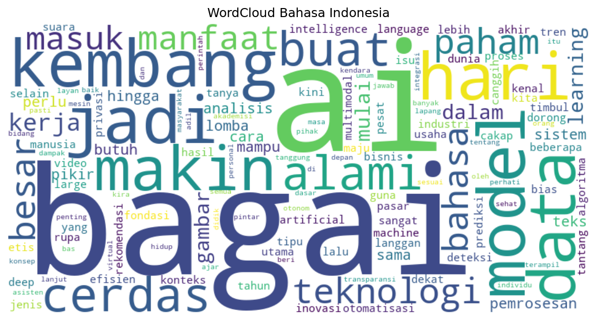

# NLP Text Preprocessing Toolkit

Toolkit preprocessing teks untuk **Bahasa Indonesia dan Inggris**, mencakup penghapusan stopword, pembersihan teks, stemming, pembuatan n-gram, dan visualisasi WordCloud. Dibuat sebagai fondasi untuk tugas NLP lanjutan seperti analisis sentimen dan klasifikasi teks.

## Fitur

| Tahap | Fungsi | Library |
|---|---|---|
| Stopword removal (Inggris) | `remove_stopwords_en` | NLTK |
| Stopword removal (Indonesia) | `remove_stopwords_id` | Sastrawi |
| Hapus URL | `remove_urls` | `re` |
| Normalisasi (huruf kecil, buang angka/simbol/emoji) | `normalize_text` | `re` |
| Stemming Bahasa Indonesia | `stem_text` | Sastrawi |
| Pipeline lengkap Indonesia | `preprocess_id` | gabungan di atas |
| N-gram (unigram, bigram, trigram, dst.) | `make_ngrams` | NLTK |
| WordCloud | `build_wordcloud`, `save_wordcloud` | wordcloud, matplotlib |

## Alur Pipeline Bahasa Indonesia

```
teks mentah -> hapus URL -> hapus stopword -> normalisasi -> stemming -> WordCloud
```

## Contoh Hasil

**Stopword removal (Inggris, NLTK)**
```
Input : Sip and rest: Enjoy your quiet Sunday morning..
Output: Sip rest: Enjoy quiet Sunday morning..
```

**Stopword removal (Indonesia, Sastrawi)**
```
Input : Sesap dan istirahat: Nikmati pagi hari Minggumu yang tenang.
Output: Sesap istirahat: Nikmati pagi hari Minggumu tenang.
```

**N-gram**
```
Teks   : Sabtu pagi saya dan istri pergi ke alun-alun
Unigram: ['Sabtu', 'pagi', 'saya', 'dan', 'istri', 'pergi', 'ke', 'alun-alun']
Bigram : ['Sabtu pagi', 'pagi saya', 'saya dan', 'dan istri', 'istri pergi', 'pergi ke', 'ke alun-alun']
Trigram: ['Sabtu pagi saya', 'pagi saya dan', 'saya dan istri', 'dan istri pergi', 'istri pergi ke', 'pergi ke alun-alun']
```

**WordCloud** dari teks contoh tentang perkembangan AI (`data/sample_text_ai.txt`):



Hasil lengkap satu kali run (termasuk 10 kata terbanyak) tersimpan di [`outputs/results.txt`](outputs/results.txt).

## Cara Menjalankan

```bash
git clone https://github.com/khoirulsr/nlp-text-preprocessing.git
cd nlp-text-preprocessing

python -m venv venv
venv\Scripts\activate          # Windows
# source venv/bin/activate     # macOS/Linux

pip install -r requirements.txt
python main.py
```

Stopword NLTK akan diunduh otomatis saat pertama kali dijalankan (butuh internet sekali saja).

Pilihan lain:

```bash
python main.py --input teks_saya.txt   # pakai teks Bahasa Indonesia sendiri
python main.py --show                  # tampilkan WordCloud di layar
```

### Dipakai sebagai library

```python
from nlp_preprocessing import preprocess_id, make_ngrams

preprocess_id("Saya sedang memancing ikan di sungai, lihat https://contoh.com")
make_ngrams("Sabtu pagi saya pergi ke alun-alun", 2)
```

## Pengujian

```bash
pytest
```

Test untuk stopword dan n-gram memakai output asli dari NLTK dan Sastrawi sebagai nilai yang diharapkan. Fungsi pembersihan (URL, normalisasi) diuji terpisah tanpa library eksternal.

## Struktur Project

```
nlp-text-preprocessing/
├── main.py                      # demo end-to-end
├── nlp_preprocessing/
│   ├── stopword_removal.py      # stopword Inggris & Indonesia
│   ├── cleaning.py              # URL, normalisasi, stemming, pipeline
│   ├── ngram.py                 # n-gram
│   └── visualization.py         # WordCloud
├── data/sample_text_ai.txt      # teks contoh
├── tests/test_preprocessing.py
└── outputs/                     # wordcloud.png dan results.txt
```

## Catatan Desain

- **Simbol diganti spasi, bukan dihapus.** Versi awal memakai `re.sub(r'[^a-zA-Z\s]', '', text)` yang menyatukan kata berhubung: "sehari-hari" menjadi "seharihari" dan "berlomba-lomba" menjadi "berlombalomba", yang lalu muncul sebagai token aneh di WordCloud. Sekarang menjadi "sehari hari" dan "berlomba lomba".
- **Penghapusan URL** (yang di versi awal masih berupa komentar) sudah diimplementasikan.
- **Unduhan `punkt` dihapus.** Tokenisasi memakai `split()`, jadi data `punkt` tidak pernah dipakai.

## Keterbatasan

- `remove_stopwords_en` memecah teks per spasi, sehingga tanda baca yang menempel ikut terbawa (contoh: `rest:` dan `morning..` pada output di atas).
- Stemmer Sastrawi dibuat untuk Bahasa Indonesia baku. Kata serapan Inggris yang umum di teks teknologi ("machine", "learning", "model") tidak di-stem, dan slang atau singkatan tidak ditangani.
- Normalisasi hanya mempertahankan huruf a-z, sehingga karakter beraksen ikut terbuang.
- Stemming teks yang sangat panjang bisa lambat karena Sastrawi berbasis aturan murni Python.

## Tech Stack

Python · NLTK · Sastrawi · wordcloud · matplotlib · pytest

## Lisensi

[MIT License](LICENSE)
